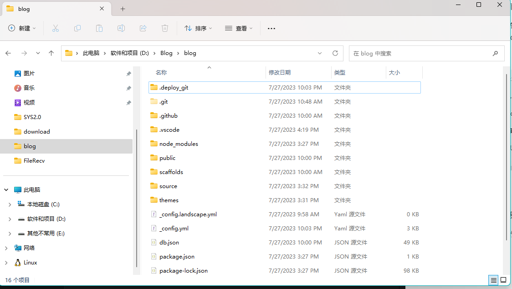
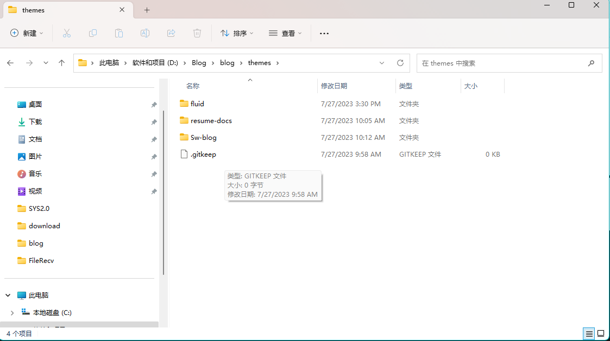
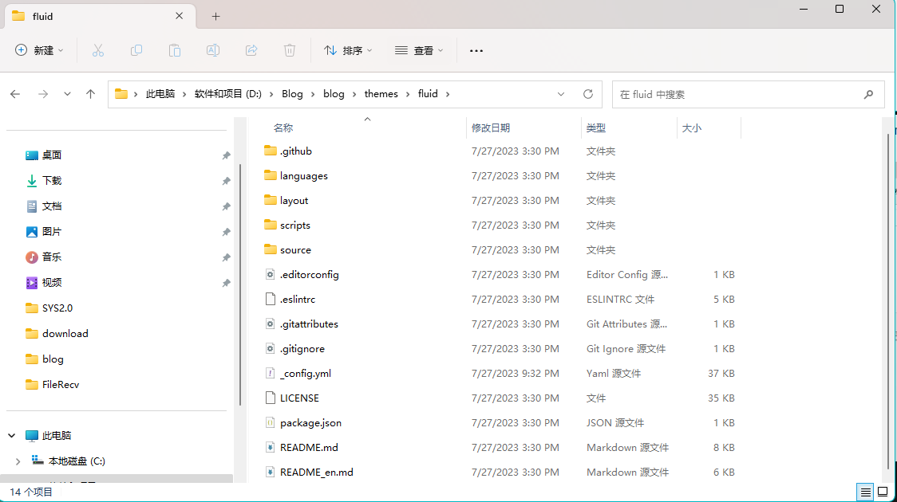
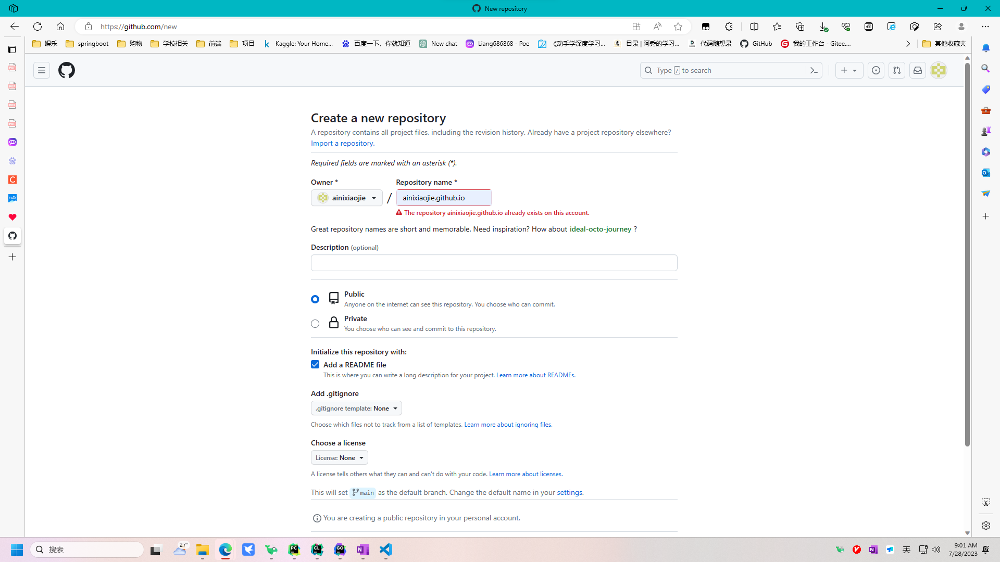
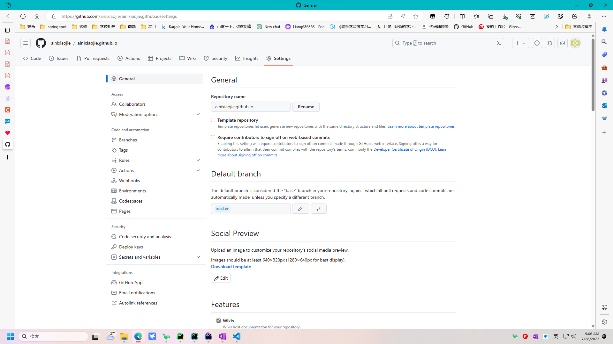
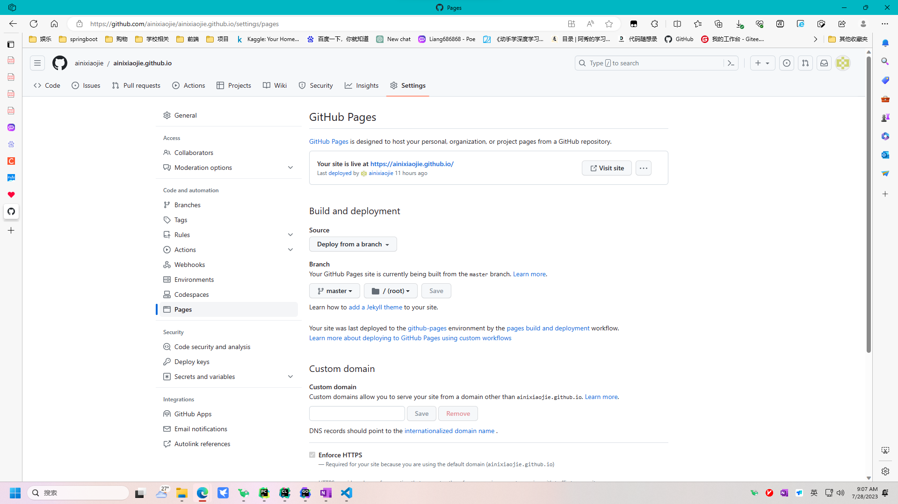
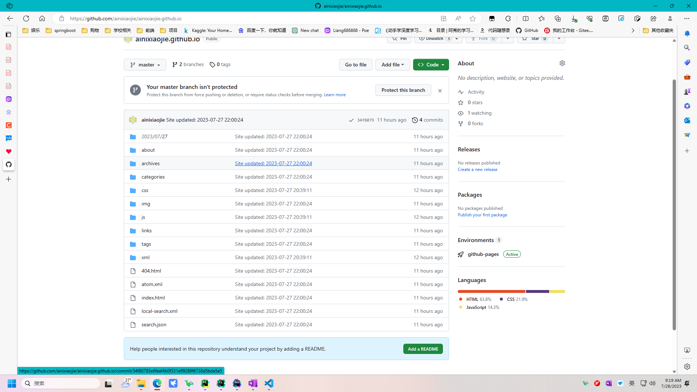

# hexo--github

# hexo
Hexo 是一个快速、简洁且高效的博客框架。Hexo 使用 Markdown（或其他标记语言）解析文章，在几秒内，即可利用靓丽的主题生成静态网页。

既然是框架，就依照框架的流程去使用它。
hexo是一个工具应用（Application）

使用流程：
```
# 第一步安装这个应用程序，hexo-cli是hexo脚手架，就是一个封装，打包好的，更方便用户使用的应用程序形式
npm install hexo-cli -g 
# 开始初始化一个博客。其实这一步，就是使用hexo-cli创建一个容器（blog目录，及其里面相关文件），然后下载一个默认主题的博客，放在容器里面。
hexo init blog
# 进入刚才使用初始化命令创建的blog目录
cd blog
# 下载相关依赖的库文件，包文件，第三方模块
npm install
# 启动hexo web程序，博客网站可以正常运行起来，此时可以浏览器输入localhost：4000，可以看到默认的hexo博客网站
hexo server
```

## 主题设置
单纯方便，还不够吸引人，吸引人还有其相应的主题

博客不同的样式就是其不同的主题

应用程序生成的blog目录下，有个themes文件夹，可以下载其他的主题放置在这个文件夹里面。

我这里有三个主题，我所下载的，fuild，resume-docs，Sw-blog这三个。默认主题landscape不在里面。

而每个主题里面的文件目录结构应该一致，大差不差



其次是配置主题，哪怕是同一个主题，设置不同，也会有不同的差异
每个主题里面都有一个_config.yml。可以在里面查看可以自己设置的设置

blog目录下，也有一个_config.yml。这个整个本地hexo的设置。两者相互配合。
若有存在对一个属性不同的设置，主题里面的生效，优先级更高。

# 配置GitHub

## 创建一个仓库repositories

仓库的名字：[GitHub_name].github.io
Add a README file这个选项，可选可不选。
勾上：就是创建readme文件，默认创建仓库main分支了。
不勾上：就是一个空的仓库，没有分支，里面啥都没有。

在创建的这个仓库里面的settings里面设置
左侧General设置：Default branch。默认是main，但是我本地使用git上传文件，创建使用的master分支，所以我修改了

左侧Pagers设置：Branch选择blog网站文件那个分支，第二个/root，是要求在该目录下能找到index.html文件。
这个设置，就是告诉github，在我这个仓库的该分支的该目录下，找到index.html文件，并在人家访问[GitHub_name].github.io网址的时候，响应这个网页。



## 上传blog网站文件
blog网站文件怎么获取，使用hexo这个应用程序

```
# 清楚缓存，清楚之前产生的文件。
hexo clean
# 这个命令会产生 .deploy_git文件夹。这个文件和github主仓库的文件一样，这个就是使用hexo，它按照要求（主题，配置文件，自己写的markdown文件），自动生成的blog网站文件
hexo generate 
# 自动deploy（部署），在_config.yml配置
hexo deploy
```




# 提示

配置就这些，对应上了就行
官方文件要一直看，跟着官方文件走 [hexo官网](https://hexo.io/zh-cn/ "Title")